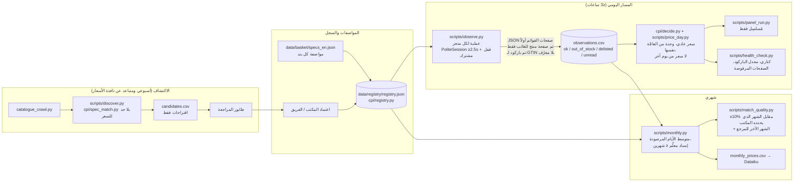

# قرار المجلس: إعادة التفكير في كود Scrapling لسلة CPI

**تاريخ القرار:** 2026-11-05
**المصادر:** `seed.md` ومحضر الجولتين (`council_transcript_ar.md`)، مع تحقق مباشر من الرئيس في الأسطر التالية:
- `scripts/compare_official_month.py:56`
- `scripts/panel_run.py:145-158`
- `scripts/scrapling_category.py:66,348-362`
- `scripts/scrapling_search.py:103-121`
- `scripts/export_basket_csv.py:55-58,76-78`
- `/home/user/cpi-rewrite/cpi/fetch.py:110-123`

**المقياس:** نسبة التطابق، أي عدد البنود التي يقع سعرها ضمن ±10% من السعر الرسمي، من أصل 637 بنداً. اليوم 251 بنداً (39%) مقابل رسمي سبتمبر.

---

## الجواب المباشر على سؤالك

**لا، هذه الفكرة لن تحقق نسبة تطابق «عالية». لكنها ترفعها رفعاً حقيقياً.**

| | العدد (من 637) | النسبة |
|---|---|---|
| اليوم | 251 | 39% |
| **المتوقع واقعياً بعد التنفيذ** | **نحو 318–345** | **50–54%** |
| سقف كارفور ولولو وحدهما | نحو 348–375 | 55–59% |

**لماذا يتسع نطاق المتوقع؟**
- الطرف الأدنى (318) يقيس مقابل رسمي **سبتمبر** (SKEPTIC-P2).
- الطرف الأعلى (330–345) يقيس مقابل رسمي **الشهر نفسه** (MATCHER-6، SKEPTIC r2).
- **المكتب هو من يحدد شهر المقارنة، ويحدده مسبقاً.** الفرق بين الطرفين تغيير في طريقة القياس، وليس تحسيناً في الأسعار.

**لماذا لا تصل إلى نسبة عالية؟**
- **113 بنداً** لا يمكن تسعيرها من الموقعين، منها 94 غير معروضة إلكترونياً أصلاً.
- **نحو 150–176 بنداً** ستُسعَّر لكنها تبقى خارج ±10%. السبب فرق حقيقي بين السعر الإلكتروني وسعر المتجر، خصوصاً في الطازج (وسيط الفجوة +10–11% حتى مقابل الشهر نفسه).
- **إغلاق هذه الفجوة بالكود يعني اختيار الإدراج الأقرب سعراً، وهذا معايرة ممنوعة** (SKEPTIC-P3، MATCHER-P11).

**أخطر تهديد الآن:** كارفور يرفض الروتين اليومي منذ 30 أكتوبر.
- إذا استمر الرفض شهراً كاملاً نخسر نحو 57 بنداً من الـ251 الحالية، إضافة إلى نحو 19–27 من المكاسب المتوقعة.
- عندها تهبط الخطة إلى **245–250**، أي **تحت مستوى اليوم** (FETCH r2، SKEPTIC r2).

---

## (أ) التشخيص في 8 أسطر

1. **قرارات المراجعة لا تجد مكاناً في الكود.** القرارات الـ253 على مستوى البند تعيش في ملف TSV خارج المستودع، والتثبيتات (pins) موزعة على ثلاثة ملفات ولا يُنشر أي منها (ARCHITECT-P1، P2).
2. **التثبيت ميت في الإنتاج.** `panel_run.py:145-158` يكتب تقدير مجموعة المنتجات (product set) ثم ينفذ `continue` قبل التثبيت. ولا يحمل أي تثبيت مخزَّن `policy_version==2`، فيُعاد اختيار كل شيء بالوسيط (`scrapling_category.py:348-362`) (ARCHITECT-P2، MATCHER-P7).
3. **سبعة مُطابِقات بقواعد مختلفة، وأربعة منها تكسر التعادل بالأرخص، وهذا مخالف للقيود.** النتيجة أن روابط مجموعات المنتجات تتبدل يومياً: 336 من 454 حالة، مقابل 0 من 297 للباركود (ARCHITECT-P3، MATCHER-P3).
4. **المقارنة في المستودع تقيس سعر العرض بدل السعر العادي** (`compare_official_month.py:56`)، فتعطي 245 بدل 251. وتحويل الوحدات يخلط بين العائلات، فيظهر سعر غرام واحد من الزعفران بـ 0.03 درهم (SKEPTIC-P1، MATCHER-P5).
5. **مجموعات الكلمات المفتاحية تتجاهل المنشأ والعلامة.** وسيط فجوتها +24%، وتسهم بصفر في الرقم القابل للنشر. وتتشارك 59 بنداً في قوائم منتجات متطابقة (SKEPTIC-P4، MATCHER-P6).
6. **الجلب يخالف القيود ويستنزف كارفور:**
   - الإيقاع 1.5 ثانية للولو و1.0 ثانية افتراضياً، والحد المطلوب ≥2.5 ثانية لكل مضيف.
   - نحو 1,100 طلب يومياً لكارفور من روتينين متزامنين.
   - الصفحة المرفوضة أو الفارغة تتحول إلى «غير موجود».

   (FETCH-P2، P3، P5، P6، ARCHITECT-P7، P8)
7. **لا توجد إشارة لنفاد المخزون.** الحقل `in_stock` فارغ في 100% من الصفوف. وسعر الكتالوج يُنشر بتاريخ اليوم وهو سعر الأمس، أي ترحيل سعر (FETCH-P4، ARCHITECT-P5).
8. **الكود المنشور منحرف عن المستودع ولا يحمل رقم إصدار.** والاختبارات مبنية على HTML مصطنع، فتمر وفيها أخطاء حقيقية، منها خطأ السعر المشطوب في لولو (ARCHITECT-P6، FETCH-P1، P10).

---

## (ب) البنية المستهدفة

### المكونات

**1. سجل المنتجات** (ARCHITECT-2 = MATCHER-4 = SKEPTIC-3، مع إضافات MATCHER r2)

مستوى البند:
- `item_code`
- `method`: exact | pin | sample | substitute | other_source | not_online
- الكمية والوحدة الرسميتان
- `shop_set`
- مرجع المواصفة

مستوى الخانة (لكل متجر):
- `slot_id`، `url`، `shop_product_id`، `gtins[]`
- `size + unit` من عائلة الوحدة الرسمية نفسها
- `origin_iso`، `basis` (weighed أو pre-pack)
- `role`، `status` (active | missing | retired)، `missing_since`
- `approved_by`، `selected_by`، `chosen_blind`
- `replaces/replaced_by` مع معامل الربط

قواعد التحقق:
- لا يوجد أي حقل اختيار مبني على السعر.
- العينة تحتاج خانتين أو أكثر لكل متجر، وإلا تُخفَّض إلى pin.
- لا يتشارك بندان في مجموعة خانات واحدة دون إعفاء من المكتب.
- كل ما يُبذر من `pins_2026-10-13.json` أو من `data/portal/cpi/pins.json` يأخذ حالة `pending`.

**2. الرصد اليومي الموجَّه** (ARCHITECT-3 مدموجاً مع FETCH-4/5/6)

- خطة جلب واحدة داخل `observe.py`، ومدخلها الوحيد هو السجل.
- المصدر الأول بيانات JSON المضمَّنة في صفحات القوائم:
  - لولو: `ean[]`، `retail_price`، `in_stock`، `country_of_origin`.
  - كارفور: `productId`، `markedPrice`، `stockLevelStatus`.
- تُجلب صفحة المنتج، مع فحص نوع الصفحة (FETCH-3)، للخانة الغائبة عن قائمة اليوم فقط.
- يُجرى بحث الباركود للرموز GTIN التي لا معرّف لها، مع مرور أسبوعي كامل.
- يُحفظ بلد المنشأ في مخزن دائم يُحدَّث شهرياً.
- **الهدف:** نحو 250–350 طلباً لكارفور يومياً بدل نحو 1,100.

**3. الاكتشاف المنفصل** (ARCHITECT-5 مع MATCHER-3)

- يعمل على الزحف الأسبوعي للكتالوج، وعلى بحث موجَّه لثغرات السجل.
- يرتّب المرشحين بملاءمة المواصفة فقط، ولا يدخل السعر في الترتيب أبداً.
- **يقترح ولا يسعّر.**

**4. طبقة القرار** (ARCHITECT-4 مع SKEPTIC-1/2)

- دالة واحدة تُستعمل في المقارنة وفي كل التصديرات.
- تعتمد السعر العادي، وتعود إلى السعر المدفوع إن لم يوجد، وتسجّل الأساس المستعمل.
- تحوّل الوحدات داخل العائلة نفسها فقط.
- الخانة غير المقروءة تأخذ حالة `not_observed`.
- لا يُستعمل سعر من يوم آخر أبداً.

**5. المخرجات**

- مخطط واحد: أعمدة `export_basket_csv.COLS` الحالية مع `slot_id` و`role` و`obs_status` و`n_slots_observed` و`single_shop` وإصدار الكود.
- ملف `monthly_prices.csv` لمنصة Dataiku.
- ملف `health.json`.
- تقرير `match_quality` يعرض رقمين: مقابل الشهر الذي يحدده المكتب، ومقابل الشهر الآخر.

**6. الصحة** (FETCH-7 مع ARCHITECT-8 وSKEPTIC-5، فحص واحد لا ثلاثة)

- 10 منتجات «كناري» لكل متجر.
- الصفحة الأولى من الفئة إن جاءت بصفر بطاقات تُسجَّل `error`.
- إنذار من اليوم الأول عند هبوط معدل إيجاد الباركود في كارفور تحت 80% من وسيط 7 أيام.
- التشغيل يأخذ حالة `error` إذا زادت حصة الصفحات غير المقروءة لمتجر عن 5%.
- **اليوم غير المقروء لا يُحسب «غياباً» للتثبيت أبداً.**

---

## (ج) جداول: يُبقى / يُحذف أو يُدمج / يُعاد كتابته

### يُبقى (KEEP)

| الملف | السبب | العضو |
|---|---|---|
| `cpi/gtin.py`, `cpi/matcher.py` (الباركود + الحجم كشرط صارم، قبول نتيجة واحدة فقط) | 229 من 249 ضمن ±10%، وصفر تبديل روابط | MATCHER, SKEPTIC, ARCHITECT |
| `cpi/quantity.py` (المحلّل) | الأساس صحيح، والخلل في طريقة استدعائه | MATCHER |
| `cpi/origin.py` | ضروري لحارس المنشأ | MATCHER |
| `cpi/retailers/carrefour.py`, `lulu.py` (`parse_product_page`، JSON-LD للتوفر) | يميّز نفاد المخزون عن غياب المنتج | FETCH, ARCHITECT |
| `cpi/fetch.py` من cpi-rewrite (PoliteSession، التصنيف، Retry-After، القاطع، القفل المشترك، FetchReport، CPI_SAVE_PAGES) | يدخل **بعد** تصحيح الإيقاع (FETCH-1) | ARCHITECT-1, FETCH, SKEPTIC-5 |
| `data/basket/specs_en.json` | نواة مستوى البند في السجل | ARCHITECT |
| فكرة التثبيت وحالة `pinned_missing` في `scrapling_category.py` | تصبح دورة حياة الخانة في السجل | ARCHITECT, MATCHER, SKEPTIC |
| `catalogue_crawl.py` (ملفات الأجزاء لكل متجر) | يصبح مغذياً للاكتشاف | ARCHITECT |
| `panel_run.py` (التقسيم إلى أجزاء والصور المصغرة) و`export_basket_csv.COLS` | المخطط الخارجي الوحيد، والمستهلكون يعتمدون عليه | ARCHITECT |
| حارس «اليوم الفارغ» في `product_panel.py` (يُعمَّم) وسلسلة Jevons للتشخيص فقط | دفاع ضد انحراف المحلّل | FETCH, MATCHER |
| المتوسط الشهري على كل الأيام المرصودة | 97.5% اتفاق بين اليوم والشهر | SKEPTIC |

### يُحذف أو يُدمج (DELETE / MERGE)

| الملف أو المقطع | المصير | العضو |
|---|---|---|
| فرع `line_prices.csv` في `panel_run.py:145-158` | يُحذف، ويسبق التثبيتُ أي تقدير | ARCHITECT-P2, MATCHER-P7, SKEPTIC |
| إعادة الاختيار بالوسيط أو بآخر سعر في `scrapling_category.py:352-362` و`PIN_MAX_MISS=3` | تُحذف، ويُكتفى بالإبلاغ | SKEPTIC-3, MATCHER-4 |
| كسر التعادل بالأرخص في `name_fallback.py:113` و`combine_run.py:66,84` و`name_live.py:93` و`fill_from_catalogue.py:45`، والوسيط في `match_catalogue_items.py:104` و`arabic_goods.py:390` | تُحذف، وتُدمج في `cpi/spec_match.py` | ARCHITECT-P3, MATCHER-3 |
| فرع «يحتفظ بالقيمة» في `refresh_catalogue_prices.py:47-51` | يُحذف لأنه ترحيل، ثم يُستبدل الملف كله بـ `observe.py` | FETCH-P8, ARCHITECT-7 |
| `catalogue_fill.py` في مسار التسعير | يُحذف من التسعير، وينتقل إلى الاكتشاف | ARCHITECT-P5 |
| `product_panel.py` (المستوى المنشور للمجموعات) | يخرج من مسار النشر، ويبقى ملف التاريخ للقراءة فقط | SKEPTIC-4, ARCHITECT-7 |
| `name_fallback.py`, `name_live.py`, `combine_run.py`, `fill_from_catalogue.py`, `match_catalogue_items.py` | تتحول إلى مولّدات مرشحين داخل `discover.py` | ARCHITECT-5 |
| `name_search.py`, `verify_pages.py`, `compare_ayesha.py`, `build_price_table.py`, `probe_retailers.py`, `ingest_lulu.py`, `export_step3.py`, `build_basket*.py` | تنتقل إلى `legacy/` خارج الحزمة، بعد وسم git | ARCHITECT-7 |
| ملفات التثبيت الثلاثة (`data/state/category_pins.json`, `data/portal/cpi/pins.json`, `data/basket/pins_2026-10-13.json`) | تُدمج في السجل بحالة `pending` | ARCHITECT-2, MATCHER r2 |
| `fetch_plan.py` المقترح كملف مستقل | يُدمج في `observe.py` | ARCHITECT r2, FETCH r2 |
| تجاوز `match_mode` في `cpi/basket.py:72,108` | يُحذف، ويصبح `basket.json` المصدر الوحيد | ARCHITECT-7 |

### يُعاد كتابته (REWRITE)

| الملف | ما يتغير | العضو |
|---|---|---|
| `scripts/compare_official_month.py` | يقارن بالسعر العادي ويعود إلى السعر المدفوع عند غيابه، ويسجّل الأساس. يقارن بالشهر الذي يحدده المكتب ويطبع الشهر الآخر. ويستبدل `FAR=3.0` بنطاق لكل مجموعة (للإنذار فقط) | SKEPTIC-1, MATCHER-6 |
| `cpi/quantity.py` و`scripts/export_basket_csv.py:55-58,76-78` | تحويل واحد داخل عائلة الوحدة: g→kg، ml→l، pc→pc | SKEPTIC-2, MATCHER-2 |
| `cpi/fetch.py` | `MIN_SHOP_DELAY=2.5` لكل قاعدة، وخوادم الصور `max_in_flight=1`، والمضاعِف `mult` في ملف المضيف المشترك، وفحص الصفحة حسب نوعها | FETCH-1, FETCH-3 |
| `scripts/scrapling_search.py` (`parse_lulu`) | صف واحد لكل رابط منتج: السعر من العقدة غير المشطوبة، والسعر العادي من المشطوبة. **يُنفَّذ بعد إصلاح المقارنة** | FETCH-2, MATCHER-1 |
| `cpi/retailers/lulu.py`, `carrefour.py` | `parse_records` و`parse_listing_json` مع فحص تقاطعي بـ CSS | FETCH-4 |
| جديد: `cpi/registry.py`, `scripts/registry_seed.py`, `scripts/check_samples.py` | السجل ومدقّقه | ARCHITECT-2, MATCHER-5 |
| جديد: `scripts/observe.py`, `cpi/decide.py`, `scripts/price_day.py` | مسار التسعير اليومي | ARCHITECT-3/4 |
| جديد: `cpi/spec_match.py`, `scripts/discover.py` | الاكتشاف | MATCHER-3, ARCHITECT-5 |
| جديد: `scripts/health_check.py`, `config/canaries.json` | الصحة | FETCH-7, ARCHITECT-8 |
| جديد: `scripts/monthly.py`, `scripts/match_quality.py` | الشهري والجودة | ARCHITECT-6, MATCHER-6 |
| `scripts/bundle_for_panel.py` | بيان حزمة يحمل git sha وبصمات الملفات، ويُرفض النشر عند عدم التطابق | ARCHITECT-1 |
| `scripts/panel_run.py` | يصبح مُسلسِلاً بنحو 80 سطراً | ARCHITECT-4 |
| `tests/` | صفحات حقيقية مضغوطة (gzip)، واختبارات انحدار للحالات المعادة دون اتصال | FETCH-8, MATCHER-3 |

---

## (د) قائمة الإجراءات مرتبة بالأثر المقاس على نسبة التطابق

**طريقة القراءة:**
- عمود «المكسب» = بنود تدخل نطاق ±10%.
- عمود «المحمي» = بنود تُمنع خسارتها.
- أوزان الثقة كما عند الناقد: عالية 1.0، متوسطة 0.7، منخفضة 0.4.
- «Sep» = مقابل رسمي سبتمبر، «Oct» = مقابل الشهر نفسه.
- **الترتيب بحسب الأثر، لا بحسب ترتيب التنفيذ.** ترتيب التنفيذ في القسم (ز).

| # | الإجراء | البنود (±10%) | الملفات | الأثر: تغطية / دقة / متانة | الجهد | الخطر | يؤيد / يعارض |
|---|---|---|---|---|---|---|---|
| 1 | **عينات ثابتة للطازج** كقوائم خانات في السجل، مختارة **عمياء** بالمواصفة والمنشأ، ومفصولة بين البنود. تجربة أولى على 61 (Sep) أو 83 (Oct) من البنود الرابحة | على الورق +61 (Sep) / +83 (Oct). بوزن الثقة نحو +40 / +55. ناقص 5–15 بسبب فصل المنشأ (SKEPTIC) أو ±5 (MATCHER). **المتوقع +30 إلى +55** | `product_panel.py` (اختيار العينة)، `check_samples.py`، `registry.json` | تغطية +166 (قد تقل). الدقة: تنتهي قوائم المنتجات المشتركة | L (أغلبه تنسيق بشري) | متوسط إلى عالٍ: دائرية الاختيار، والأصناف الموسمية | الجميع يؤيد، والخلاف على الحجم فقط |
| 2 | **إبقاء كارفور مقروءاً ضمن القواعد:** دمج طبقة الجلب مع إيقاع 2.5 ثانية ومضاعِف مشترك، وخفض الحجم إلى نحو 300 طلب يومياً عبر JSON القوائم، وإنذار معدل الباركود، وطرح سؤال الجهاز الثابت على المستخدم | **0 مكسب، ويحمي نحو 57 بنداً حالياً + 19–27 مكسباً متوقعاً = 75–85** | `cpi/fetch.py`، `observe.py`، `health_check.py`، `docs/routines/*.md` | المتانة: الصفحة المرفوضة تُبلَّغ ولا تتحول إلى «غير موجود» | M | متوسط: قد لا يعيد خفضُ الحجم كارفور إذا كان السبب سمعة عنوان IP | FETCH وARCHITECT: السبب الحجم. SKEPTIC: السبب سمعة IP. **سبب الحجب مختلَف عليه** |
| 3 | **القياس الصحيح:** السعر العادي في المقارنة، والشهر الذي يحدده المكتب مسبقاً | +6 في رقم المستودع (245→251). +4 لليوم بالشهر نفسه (≈255). +26 للإسقاط (348→374). **تغيير قياس لا تسعير** | `compare_official_month.py:49-64,56`، `cpi/decide.py` | الدقة: مفهوم سعر واحد للمتجرين | S | منخفض. خطر معايرة إذا اختير الشهر بعد رؤية النتيجة | الجميع يؤيد. ARCHITECT وFETCH: لا يُجمع مع مكاسب الكود |
| 4 | **سجل التثبيتات** بلا إعادة اختيار آلية، والتثبيت يسبق مجموعة المنتجات، وحذف الأرخص والوسيط | تثبيت: +15 (Sep) / +17 (Oct)، بالوزن ≈ +11 / +12 | `cpi/registry.py`، `registry_seed.py`، `panel_run.py:145-158`، `scrapling_category.py:66,352-362` | المتانة: تنتهي تبدلات الروابط. التغطية: +22 | M | متوسط: عبء اعتماد بشري | الجميع يؤيد |
| 5 | **تحويل وحدات من العائلة نفسها** في مكان واحد | +10 (Sep) / +8 (Oct)، 5 منها بثقة عالية. تغطية +19 | `cpi/quantity.py`، `export_basket_csv.py:55-58,76-78`، `compare_official_month.py` | الدقة: الزعفران، والقطعة مقابل الكيلو | S | منخفض | الجميع يؤيد |
| 6 | **بدائل العلامة** في السجل بعد قرار المكتب | +12 على الورق، ≈ +7 بالوزن | `registry.json` (`role=substitute`) | تغطية | S للكود، والقرار للمكتب | يتوقف على المكتب | الجميع، بشرط قرار المكتب |
| 7 | **تجربة يونيون كوب** كمتجر ثالث في السجل، **فقط** إن سمح robots والشروط وقُدمت الصفحات دون تحدٍّ (challenge) | غير مقاس: من 0 حتى نحو 50 (SKEPTIC)، أو 25–45 (MATCHER) | `cpi/retailers/unioncoop.py`، `config/retailers.json` | **الرافعة الوحيدة فوق السقف** | L | عالٍ: قد يرفض الموقع، وأسعار الأعضاء (Tamayaz) مستبعدة، ويلزم قبول المكتب متوسط 3 متاجر | الجميع يؤيد الفحص. لم يُجرَ أي طلب حتى الآن |
| 8 | **مطابِق مواصفات واحد** (`spec_match`) يعمل في الاكتشاف فقط | الصافي −2 إلى +3: يصلح 3–4 حالات `wrong_product`، ويُخرج حالتين متطابقتين بالصدفة | `cpi/spec_match.py`، `discover.py`، `name_fallback.py`، `name_live.py`، `combine_run.py` | الدقة: يمنع اعتماد اختيار أول خاطئ (الكرواسون، الهريس) | S–M | منخفض | الجميع. **إلزامي بحكم القيود** |
| 9 | **تحسينات الباركود:** هوية الباركود تتقدم على تسمية الوحدة pcs/g، ولا يسقط سطر باركود إلى مجموعة | صغير وغير مقاس. يستعيد نحو 31 صفاً لكل متجر كل 12 يوماً من `qty_unit_differs` | `cpi/matcher.py:130-136`، `food_spec_fixes.py:88-95` | تغطية ودقة (حالة الروبيان +69.5%) | S | منخفض، مع مراجعة | MATCHER، ولا معارض |
| 10 | **نفاد المخزون حالة رصد**، والتثبيت لا يُعاد اختياره أثناء النفاد | 0 مكسب، تغطية +3 (بنود مُسنَدة، **لا تُحسب ضمن ±10%**). يحمي مكاسب البند 4 والبند 1 | `observe.py`، `match_run.py`، `scrapling_category.py` | متانة، واتساق مع قواعد الإسناد | M | منخفض | الجميع |
| 11 | **إصلاح محلّل عروض لولو**، **بعد البند 3 فقط** | **0**، ويصبح سالباً إن نُفِّذ قبل البند 3 | `scrapling_search.py:103-121`، `tests/fixtures/pages/` | دقة التدقيق، وإشارة عروض لفحص الصحة | S | منخفض بشرط الترتيب | الجميع (FETCH وMATCHER تراجعا عن ترتيبه أولاً) |
| 12 | **البيان وإصدار الكود، وجدولة الكتالوج خارج نافذة الأسعار، والمجمّع الشهري** | **0**. تُغلق خرق الترحيل (171 صفاً) والانحراف عن المستودع | `bundle_for_panel.py`، `docs/routines/README.md`، `monthly.py` | متانة والتزام | S–M | منخفض | الجميع |

**الحساب الإجمالي الصادق:**
- 251 + (البنود 1 و3 و4 و5 و6 و8 و9 بالوزن) ≈ **318–345**.
- يتوقف ذلك على شهر المقارنة وعلى ما يبقى بعد إعادة الاختيار العمياء.
- **يُشترط** أن يبقى كارفور مقروءاً (البند 2).
- يونيون كوب خارج هذا الحساب حتى يُقاس.

### إجراءات حُذفت لمخالفتها القيود

| الإجراء | سبب الحذف |
|---|---|
| **FETCH-9**: تشغيل استدراك في اليوم نفسه قد يعمل من عنوان IP سحابي آخر | قريب من «الالتفاف على الحجب». سحبه FETCH نفسه، وبقي منه عدّاد أيام الرصد فقط |
| **إعادات التشغيل اليدوية من «جلسة سحابية منفصلة»** (3 نوفمبر) كآلية منهجية | لا تُعتمد حتى يؤكد المستخدم أنها ليست التفافاً على الحجب |
| **اختيار شهر المقارنة بعد رؤية أيهما أفضل** | معايرة للمقياس. يحدد المكتب الشهر مسبقاً |
| **أي اختيار لإدراج أقرب إلى السعر الرسمي**، بما فيه إغلاق فجوة الطازج بالكود | معايرة ممنوعة. حارس MATCHER-6 (±40% للتثبيت الجديد) يُبقى **للإنذار فقط**: لا يعتمد ولا يرى المختارُ نتيجته |
| **إبقاء `catalogue_fill` و`refresh_catalogue_prices` في مسار التسعير** | ترحيل سعر |
| **أي إبقاء للأرخص أو الوسيط كقاعدة اختيار** | مخالف للقيود |

---

## (هـ) خلافات لم تُحسم

**1. الرقم الرئيسي: سبتمبر أم الشهر نفسه؟**
- SKEPTIC: نحو 318 متوقعاً وسقف 348 مقابل سبتمبر.
- MATCHER: 330–345 متوقعاً وسقف 375 مقابل أكتوبر.
- ARCHITECT وFETCH: تغيير قياس لا يُجمع مع مكاسب الكود.
- **الحل الوسط المعتمد:** يُنشر الرقمان معاً. الرقم الرئيسي يحدده المكتب مسبقاً، بعد تأكيد أن عمود «الرسمي أكتوبر» نهائي.

**2. سبب حجب كارفور**
- FETCH وARCHITECT: حجم الطلبات (نحو 1,100 يومياً).
- SKEPTIC: سمعة عنوان IP الخاص بعميل الروتين. حجته أن الجلسة اليدوية قرأت 363 صفحة بإيقاع 2.5 ثانية مع 0 فشل، بينما رُفض الروتين من الصفحة الأولى.
- **غير محسوم.** يُنفَّذ خفض الحجم في كل الأحوال، ويُقاس الهدف بـ ≥15 يوماً مقروءاً لكارفور في نوفمبر.

**3. حجم مكسب العينات الثابتة**
- على الورق +61 (Sep) / +83 (Oct).
- SKEPTIC: ≈ +40 / +56 ناقص 5–15 بسبب فصل المنشأ.
- MATCHER: ≈ +55، وفصل المنشأ ±5، والدائرية أضعف مما يُظن لأن الأرقام تحسنت مقابل أكتوبر.
- FETCH: 30–45.
- **يُحسم بالتجربة العمياء** على البنود الرابحة وعلى المجموعات الـ23 المشتركة.

**4. يونيون كوب**
- SKEPTIC: حتى نحو 50.
- MATCHER: 25–45.
- FETCH: غير معروف.
- لم يُرسل أي طلب للتحقق من robots والشروط. **يبقى مجهولاً حتى الفحص.**

**5. حجم الرصد اليومي**
- ARCHITECT: 450–650 طلباً لكل متجر.
- FETCH: 250–350 لكارفور.
- **يتوقف على قياسين:** هل تتضمن القوائم المنتجات النافدة؟ وما حصة المعرّفات المحلولة التي تظهر في قوائم يوم واحد (إذا كانت أقل من 90% يبقى البحث اليومي بالباركود)؟

**6. بنود مجموعات المنتجات الـ247 يوم التحويل**
- خيار أول: تُعرض «بانتظار السجل» بلا سعر.
- خيار ثانٍ: تبقى تقديرات موسومة في ملف منفصل غير قابل للنشر.
- مفتوح (سؤال ARCHITECT).

**7. الرصد يوماً بعد يوم لخانات GTIN** لتنصيف حمل كارفور
- ARCHITECT: آمن للنسبة.
- **القرار للمكتب.**

---

## (و) ما لا يصلحه الكود، ومن يقرر

| المسألة | الحجم | من يقرر |
|---|---|---|
| بنود غير معروضة على الموقعين | 94 `other_source` (62 منها تذكر يونيون كوب). المجموع غير المغطى 113 | **المكتب** (مصدر آخر أو جمع ميداني). **المستخدم** يقرر تجربة يونيون كوب |
| مزيج منافذ البيع | المكتب يجمع من 4 متاجر ونحن نرصد 2. سلع العدّاد والسائب مقابل المعبأ. نحو 150–176 بنداً مسعّرة خارج النطاق، 125 منها فوق الرسمي | **المكتب**: أسعار رسمية لكل متجر، وقبول متوسط 3 متاجر أو متوسط لولو وحدها لبنود أثر المتجر |
| مفهوم السعر عند العرض (سعر الرف المخفض أم العادي) | يغيّر المستوى ويغيّر اختبار التغير (+0.92% عرض، +0.69% عادي، +0.36% رسمي) | **المكتب** |
| المقياس المستهدف (المستوى ضمن ±10% أم اتفاق التغير الشهري، والشهر نفسه أم السابق) | للطازج يبقى وسيط المستوى نحو +10% حتى بالشهر نفسه، فاتفاق التغير هو الاختبار الممكن | **المكتب**، مسبقاً |
| بدائل العلامة | +12 على الورق | **المكتب** |
| منهج الإسناد ونافذته (≤ شهرين) والإعفاء من تشارك العينات | — | **المكتب** |
| مكان تشغيل الروتين (جهاز ثابت معتمد، مثل خادم Dataiku) وشرعية الاستدراك | الرافعة الأكبر للمتانة ضمن القيود | **المستخدم** (Digital Dubai) |
| مكان السجل المعتمد (JSON في الحزمة أم مجموعة في اللوحة قابلة للتعديل، مع سقف 100 MB) واعتماد الاستبدالات اليومية | — | **المستخدم مع المكتب** |

---

## (ز) ترتيب التنفيذ: 6 أسابيع

### الأسبوع 1: قياس صحيح وجلب ملتزم

**المهام:**
- SKEPTIC-1 وMATCHER-6 في `compare_official_month.py`.
- SKEPTIC-2 وMATCHER-2 في `cpi/quantity.py` و`export_basket_csv.py`.
- دمج `cpi/fetch.py` مع FETCH-1 (2.5 ثانية لكل قاعدة، مضاعِف مشترك، خوادم الصور 1×2.5 ثانية).
- بيان الحزمة (ARCHITECT-1).

**الاختبارات:**
- كل `SiteRule` ≥2.5 ثانية.
- جلستان على المضيف نفسه تتشاركان المضاعِف.
- حالات الوحدات: زعفران 1 غ، أناناس بالقطعة، كرواسون 102 غ.

**القبول:**
- رقم المستودع يعيد 251 مقابل سبتمبر، ويطبع نحو 255 مقابل أكتوبر في سطر منفصل.
- لا توجد قاعدة إيقاع أقل من 2.5 ثانية.
- `run.json` يحمل git sha.
- النشر يُرفض عند عدم تطابق البيان.

### الأسبوع 2: صفحات حقيقية وفحوص

**المهام:**
- FETCH-8: تثبيتات صفحات حقيقية.
- FETCH-3: فحص نوع الصفحة.
- FETCH-2: محلّل لولو، **بعد الأسبوع 1**.
- FETCH-4: محلّلات JSON مع فحص تقاطعي.
- `health_check.py` (FETCH-7 مع ARCHITECT-8).
- **قياس:** حصة المعرّفات المحلولة الظاهرة في قوائم يوم واحد.

**الاختبارات:**
- Lazeez 5 كغ: 21.50 سعراً و29.95 سعراً عادياً.
- صفحة الهيكل الفارغ (53 بايت) تُصنَّف `error`.
- الصفحة الأولى بلا بطاقات تُصنَّف `error`.

**القبول:**
- الصفحات المرفوضة تظهر في التقرير اليومي بعددها.
- صفر بلد منشأ مخزّن من صفحة غير مفحوصة.
- حصة العروض في لولو أكبر من 0.

### الأسبوع 3: السجل

**المهام:**
- `cpi/registry.py` و`registry_seed.py` و`cpi/spec_match.py`.
- حذف فرع `panel_run.py:145-158` وإعادة الاختيار في `scrapling_category.py:352-362` و`PIN_MAX_MISS`.
- حذف كسر التعادل بالأرخص.
- التثبيتات القديمة تدخل بحالة `pending`.
- إرسال الكرواسون والهريس للمراجعة.

**الاختبارات:**
- انحدار Sunflow، Al Baker No.2، Meliha UHT، Weetabix.
- المدقّق يرفض حقل اختيار بالسعر ويرفض الخانات المشتركة.

**القبول:**
- حصة البنود ذات خانة مثبتة **ومعتمدة** تُعلن، وهدفها ≥ حصة اليوم (289 بنداً) إضافة إلى تثبيتات المراجعة.
- صفر مسار يختار بالأرخص أو بالوسيط (فحص بـ grep واختبار).

### الأسبوع 4: الرصد والقرار في وضع الظل (shadow)

**المهام:**
- `observe.py` و`cpi/decide.py` و`price_day.py` يعملان بالتوازي مع المسار الحالي.
- حالة نفاد المخزون (FETCH-6).
- نقل الاكتشاف (`discover.py`) وروتين الكتالوج خارج نافذة الأسعار.

**القبول:**
- طلبات كارفور ≤ نحو 350 يومياً، وزمن التشغيل < 3 ساعات.
- صفر صف بتاريخ اليوم مصدره كتالوج الأمس.
- اليوم غير المقروء لا يُحسب «غياباً» لأي تثبيت.
- فرق الظل مقابل الإنتاج على بنود الباركود صفر تبديل روابط.

### الأسبوع 5: تجربة العينات العمياء ويونيون كوب

**المهام:**
- إعادة اختيار البنود الرابحة (61 مقابل Sep / 83 مقابل Oct) بالمواصفة فقط، مع `chosen_blind=true`.
- `check_samples.py` يفرض فصل المنشأ.
- تجربة على المجموعات الـ23 المشتركة.
- **بالتوازي، بعد موافقة المستخدم:** فحص robots والشروط ليونيون كوب، بإيقاع مهذب، والتوقف عند أي رفض.

**القبول:**
- يُعلن عدد ما بقي ضمن ±10% بعد الاختيار الأعمى.
- لا تتشارك بنود في مجموعة خانات واحدة دون إعفاء.

### الأسبوع 6: التحويل والتنظيف

**المهام:**
- تحويل النشر إلى `price_day` بعد أسبوعين من الظل.
- إخراج مجموعات المنتجات من النشر.
- `monthly.py` و`match_quality.py`.
- نقل الكود القديم إلى `legacy/`.

**القبول، ويُعلن الرقمان دائماً (Sep وOct):**

| المؤشر | الهدف |
|---|---|
| ضمن ±10% | **≥ 318** مقابل سبتمبر، أو **≥ 330** مقابل الشهر نفسه |
| حصة البنود المثبتة | تُعلن |
| حصة البنود من متجر واحد | تُعلن |
| أيام كارفور المقروءة في الشهر | ≥ 15 |
| حصة الصفحات غير المقروءة | ≤ 5% لكل متجر، وإلا يُسجَّل التشغيل `error` |
| زمن التشغيل | < 3 ساعات |
| الأسعار المرحَّلة | صفر |
| البنود المُسنَدة | معلَّمة ولا تُحسب في ±10% |

**إذا لم يُقرأ كارفور:** يُعلن الرقم كما هو (نحو 245–250)، ولا يُستعاض عنه بأي تحايل.
